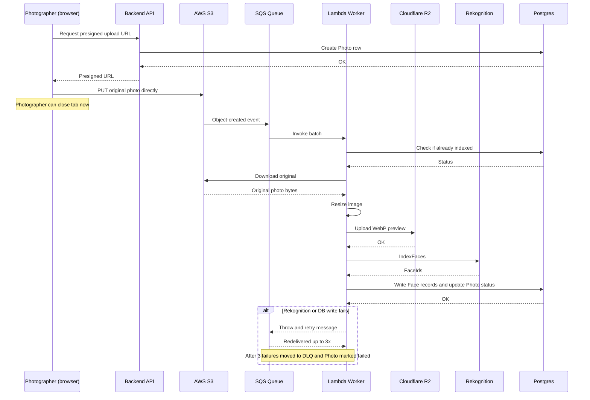
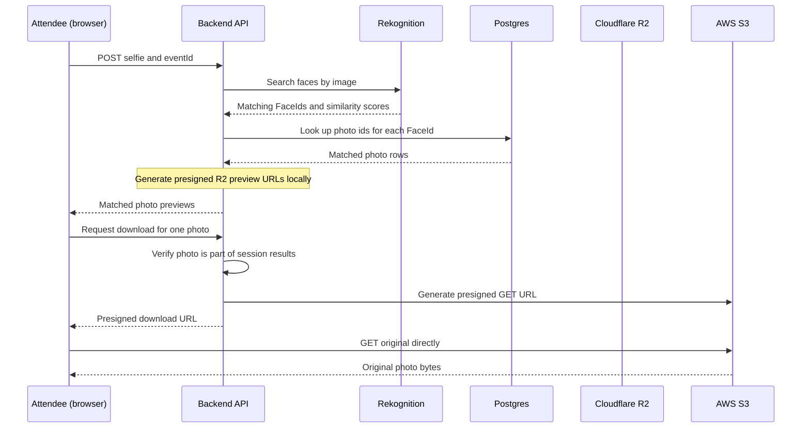

# Facet 📸

Facet is an event photography platform connecting photographers with
attendees through automated face-recognition indexing. Photographers
batch-upload event photos; attendees find their own photos by
uploading a selfie, no account or manual tagging required.

Built as a full production-shaped system — not a demo — with an
async processing pipeline, presigned-URL upload/download flows, and
deliberate tradeoffs made and documented along the way.

## 🌟 Key Features

- **Selfie-based photo search** — attendees upload a selfie; the
  backend queries AWS Rekognition against that event's face
  collection and returns matching photos. No account required.
- **Asynchronous batch indexing** — photographers upload directly to
  S3 via presigned URLs. Indexing (resize, face detection, database
  writes) happens independently via SQS + Lambda, and survives the
  photographer closing their browser mid-upload.
- **Dual-storage split** — full-resolution originals live in S3
  (native Rekognition integration); compressed WebP previews are
  served from Cloudflare R2 (zero egress fees on the highest-traffic
  path — attendees browsing galleries).
- **DLQ resilience & failure tracking** — Lambda monitors SQS retry
  counts (`ApproximateReceiveCount`); on the 3rd failed attempt, it
  updates the photo status to `FAILED` in PostgreSQL before SQS moves
  the message to the Dead Letter Queue (DLQ).
- **Idempotent, retry-safe indexing** — Lambda checks photo status
  before processing, so SQS's at-least-once delivery can never
  double-index a photo or create duplicate face records.
- **Multi-tier rate limiting** — IP-aware rate limiting (`express-rate-limit`
  with `trust proxy: 1`) protecting sensitive endpoints: search (30 req/min),
  photo downloads (60 req/min), contact form (5 req/15min), and authentication (10 req/15min).
- **Client-side selfie normalization** — browser-side HTML5 Canvas
  resizes and normalizes attendee selfies (<1280px, ~200KB JPEG)
  before transmission, preventing mobile upload timeouts and AWS
  Rekognition 5MB payload exceptions.
- **Free-tier quotas & spend protection** — strict backend limits protect
  cloud resources (max 5 active events per photographer, max 150 photos per event).
- **Passwordless + social auth** for photographers via Better-Auth
  (email/password + Google OAuth). Attendees remain guest/session-based
  by design.

## 🏗️ Architecture


### Upload → Index sequence (asynchronous, survives disconnect)

This is the flow most worth understanding: the photographer's browser
is only involved in the upload step. Everything after that runs
independently, server-side.



### Selfie search → download sequence



## 🎯 Design Decisions & Tradeoffs

A few deliberate choices worth calling out — these reflect real
tradeoffs made during the build, not defaults:

- **Attendees are guest/session-based, with no accounts.** An
  attendee-account system (with search history across events) was
  designed, then deliberately reverted — the added complexity
  (a `users` module, cross-session identity linking after a guest
  search) outweighed the benefit versus "keep your event link."
- **Client-side Canvas normalization instead of server re-encoding.**
  Rather than uploading 15–25MB raw phone camera captures and resizing
  on Node.js/Lambda, the attendee's browser normalizes selfies to a max
  1280px dimension at 82% JPEG quality via an offscreen HTML5 Canvas.
  This saves mobile upload bandwidth, lowers API latency, and eliminates
  AWS Rekognition's 5MB payload limit exceptions.
- **Fail-fast SQS DLQ status persistence.** AWS SQS redelivers failed
  messages up to 3 times before moving them to the Dead Letter Queue.
  Without explicit worker tracking, database rows would remain permanently
  stuck in `PROCESSING`. The Lambda worker checks `ApproximateReceiveCount >= 3`
  in its error handler to record `FAILED` status in PostgreSQL before
  re-throwing the error to let SQS route it to the DLQ.
- **Cursor-based pagination**, not offset-based, for photo galleries.
  Offset pagination breaks visibly when a photographer uploads more
  photos while an attendee is mid-scroll; cursor pagination doesn't.
- **Reverse proxy trust configuration (`trust proxy: 1`).** Express is
  configured to trust the immediate front-facing reverse proxy (e.g.
  Nginx, Caddy, or Cloudflare), enabling accurate IP tracking for rate
  limiters while preventing client-controlled `X-Forwarded-For` header
  spoofing.
- **Two separate Prisma schemas** (backend: full; Lambda: `Photo` +
  `Face` only) instead of a shared package. Accepted duplication over
  cross-project workspace tooling complexity — the tradeoff is that
  schema changes to shared models must be applied in both places by
  hand.
- **Migrated to Prisma 7 mid-build**, moving datasource config out of
  `schema.prisma` into `prisma.config.ts` and adopting Neon's
  serverless HTTP driver via `@prisma/adapter-neon` — removes the
  compiled query-engine binary from the Lambda deployment entirely,
  which also resolved a recurring Lambda package-size problem.

## ⚠️ Known Limitations

Documented deliberately, not omitted by oversight:

- No bulk "download entire event" (single-photo and matched-set bulk
  download only)
- In-memory rate limiting (single-instance; Redis store required for distributed multi-region clustering)
- Free-tier event and photo quotas (max 5 active events per photographer, max 150 photos per event)
- Single face search per query (AWS Rekognition matches the largest detected face in an attendee selfie)
- No expiring/revocable share links — links are permanent per event (atleast for now)
- No attendee accounts

## 📁 Repository Structure

<details open>
<summary><b>Frontend (Next.js)</b></summary>

```text
frontend/
├── src/
│   ├── app/                  # App router pages
│   │   ├── (auth)/           # Authentication routes (login, register)
│   │   ├── (attendee)/       # Attendee public event search & gallery UI
│   │   └── (photographer)/   # Photographer dashboard, events & uploads
│   ├── components/           # Shadcn UI library, attendee & photographer components
│   ├── hooks/                # React Query custom hooks for data fetching & mutations
│   ├── lib/                  # Shared utilities, auth client & API helpers
│   ├── providers/            # React context providers (Auth, Query)
│   ├── store/                # Zustand stores (attendee search session & UI state)
│   └── types/                # TypeScript interface definitions
├── package.json
└── tailwind.config.ts
```
</details>

<details open>
<summary><b>Backend (Express.js)</b></summary>

```text
backend/
├── src/
│   ├── app/
│   │   ├── common/           # Shared config, middleware & utilities
│   │   │   ├── config/       # Environment, mailer, Prisma, S3, R2, Rekognition
│   │   │   ├── middleware/   # Multi-tier rate limiters, error handling, validation
│   │   │   └── utils/        # ApiError, ApiResponse helpers
│   │   ├── modules/          # Domain-driven feature modules
│   │   │   ├── auth/         # Better-Auth integration & credentials
│   │   │   ├── contact/      # Contact form handling & Nodemailer delivery
│   │   │   ├── events/       # Event CRUD, PIN protection & quota enforcement
│   │   │   ├── photos/       # Presigned upload URLs & event photo limits
│   │   │   ├── search/       # Face matching via Rekognition & download verification
│   │   │   └── webhooks/     # Webhook listeners
│   │   └── app.ts            # Express application setup, routes & rate limiters
│   └── server.ts             # Express server entry point & HTTP listener
├── prisma/                   # Database schema & migrations
└── package.json
```
</details>

<details open>
<summary><b>Lambda (Serverless Worker)</b></summary>

```text
lambda/
├── src/
│   ├── handlers/             # SQS Event consumers (indexPhoto.js)
│   ├── services/
│   │   ├── dbService.js      # Postgres/Prisma interactions & failure status
│   │   ├── imageService.js   # Sharp image resizing (WebP)
│   │   ├── r2Service.js      # Cloudflare R2 WebP uploads
│   │   ├── rekognitionService.js # AWS Rekognition IndexFaces
│   │   └── s3Service.js      # Downloading original photos from S3
│   ├── utils/                # Helper functions
│   └── config.js             # Environment configuration
├── prisma.config.ts          # Prisma CLI config
├── deploy.ps1                # Packaging/deployment script (Windows)
└── INFRASTRUCTURE.md         # AWS infrastructure, IAM, and SQS/DLQ guide
```
</details>

## 🚀 Tech Stack

| Layer | Choice |
|---|---|
| Frontend | Next.js, React, Tailwind CSS, Framer Motion, Shadcn UI, React Query, Zustand |
| Backend | Express.js 5, TypeScript, Better-Auth, Prisma ORM 7, PostgreSQL (pg / Neon), express-rate-limit, Nodemailer, Zod |
| Worker | AWS Lambda (Node.js), Sharp (Linux binary), AWS SDK v3 |
| Cloud & Storage | AWS S3 (Originals), Cloudflare R2 (WebP Previews), AWS SQS + DLQ, AWS Rekognition |
| Database | Neon (serverless PostgreSQL), Prisma ORM 7 |

## 🛠️ Local Setup

1. **Clone the repository**
   ```bash
   git clone <repo-url>
   cd Facet
   ```

2. **Configure environment variables**
   - Copy `.env.example` → `.env` in both `backend/` and `lambda/`.
   - Fill in AWS, Cloudflare, Neon, and SMTP credentials.
   - Point `frontend/.env.local` at your local backend API.

3. **Install dependencies** (three independent projects — no shared
   workspace tooling, install each separately)
   ```bash
   cd backend && npm install
   cd ../frontend && npm install
   cd ../lambda && npm install
   ```

4. **Run backend + frontend**
   ```bash
   # Terminal 1
   cd backend && npm run dev

   # Terminal 2
   cd frontend && npm run dev
   ```

5. **Deploy the Lambda** (Windows/PowerShell)
   ```powershell
   cd lambda
   npm run build   # prisma generate + force Linux Sharp binary + prune devDependencies
   .\deploy.ps1    # packages lambda.zip
   ```
   Upload `lambda.zip` via the AWS Lambda console. See `lambda/INFRASTRUCTURE.md`
   for IAM policies, SQS/DLQ settings, and the full manual deployment checklist.